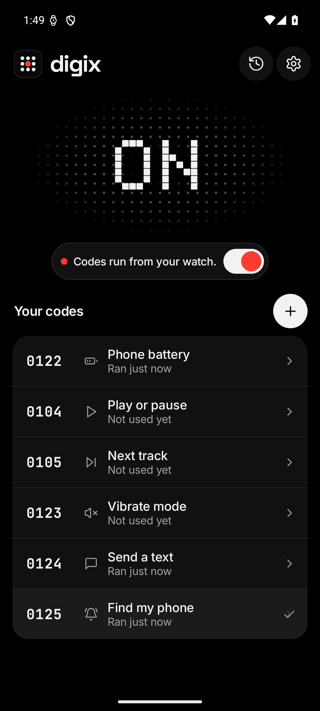
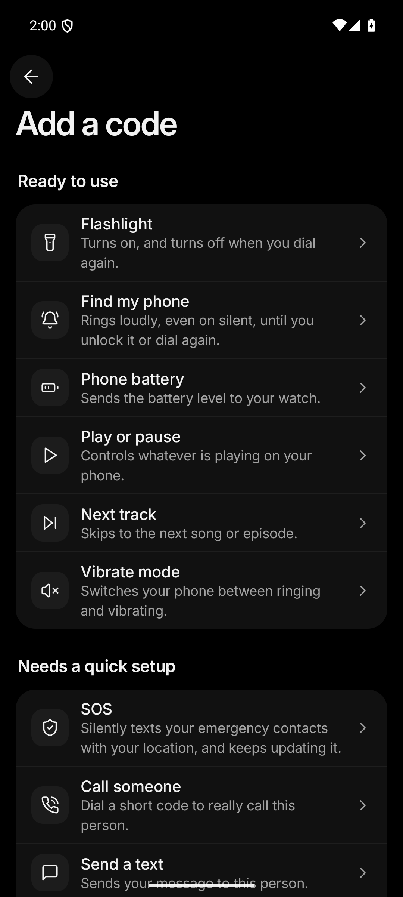

# DigiX

Turn your Bluetooth watch’s dial pad into shortcuts for your Android phone.

Assign a short code to a phone action, then dial it from a watch connected for Bluetooth calling. DigiX catches the saved code on the phone and runs the action. You can find your phone, control music, send a prepared message, share your location, or start a voice conversation with your chosen AI provider.

The phone app uses the original Halo + Quiet design, with a dot-matrix halo, readable code lists, and a single switch for everyday actions. Setup happens on the phone. Your watch uses its existing dial pad.

<p>
  
  
</p>

These screenshots show the Play edition running on an Android emulator with example codes.

[Download the APK](https://github.com/harsha20599/digix/releases/latest/download/DigiX.apk) · [All GitHub releases](https://github.com/harsha20599/digix/releases) · [Google Play](https://play.google.com/store/apps/details?id=com.littyl.digix.play) · [Privacy policy](https://digix-privacy.vercel.app/) · [License](LICENSE)

## Contents

- [Getting started](#getting-started)
- [Actions](#actions)
- [Permissions and setup](#permissions-and-setup)
- [Editions and upgrades](#editions-and-upgrades)
- [Privacy and data](#privacy-and-data)
- [Build from source](#build-from-source)
- [Testing](#testing)
- [Project layout](#project-layout)
- [Troubleshooting](#troubleshooting)
- [License and credit](#license-and-credit)

## Getting started

You need an Android phone running Android 10 or later and a watch that can place calls through that phone over Bluetooth. Keep Bluetooth calling connected and use the watch’s dial pad for your saved DigiX codes.

1. Download **DigiX.apk** from GitHub Releases and install it on your phone, or install the approved Google Play edition. Android may ask you to allow installation from the browser or file manager you used. Source build and signing instructions are below.
2. Open DigiX on the phone and complete onboarding. Grant Android’s call-redirection role when prompted.
3. Try the introductory code from the watch and check the result in DigiX’s Activity screen.
4. Add an action, choose its code, and finish any permission or setup steps shown for that action.
5. Dial the saved code from the watch. Enable **Speak results** in Settings if you want supported actions to answer with a spoken result through the watch.

Physical watch testing documented by the project covers the OnePlus Watch 3. Verify your own phone, watch, Android version, and carrier combination before relying on an action. The watch must route the dial through the paired phone for DigiX to receive it.

### Codes and ordinary calls

DigiX compares outgoing numbers against the codes you saved. Ordinary numbers pass through to the phone’s dialer. Saved codes are canceled or redirected into a local reply call, depending on the action and your settings. A **Call someone** action redirects its code into a real phone call to the saved recipient.

The editor checks code length, duplicates, known emergency prefixes, and Android’s emergency-number list. Keep codes in the app’s suggested range. While DigiX holds the call-redirection role, turning off everyday actions also keeps their codes intercepted. Removing DigiX or its call-redirection role returns dialing to Android’s normal behavior, so remove saved watch shortcuts when you stop using the app.

## Actions

| Action | What it does | Setup or conditions |
| --- | --- | --- |
| Flashlight | Toggles the phone’s torch | Phone hardware must support a torch |
| Find my phone | Plays a loud alert, including while the phone is on silent | Stops when you unlock the phone or dial the code again |
| Phone battery | Reports the battery level | Spoken replies use the local reply-call flow |
| Play or pause | Controls the active media session | Depends on the media app accepting Android media controls |
| Next track | Sends a next-track command | Depends on the active media session |
| Vibrate mode | Switches between ringing and vibrating | Uses Android audio controls |
| Do Not Disturb | Changes the app’s Do Not Disturb setting | Requires notification-policy access |
| Call someone | Calls the recipient saved for the code | Uses the phone’s normal calling service |
| Send a text | Sends a prepared SMS to the saved recipient | Requires SMS permission and mobile service |
| Share my location | Texts the saved recipient a map link | Requires SMS and location access, with background access for watch-triggered use in the Play edition |
| WhatsApp message | Opens the prepared message and uses the helper to press Send | Requires WhatsApp, an unlocked phone, and the Accessibility helper |
| SOS | Sends an alert and location updates to your chosen contacts | Requires contact setup, SMS, location, and background execution permissions |
| Web request | Sends an HTTP POST to the address you configured | Requires a reachable endpoint |
| Wi-Fi | Toggles Wi-Fi through a supported Android control path | Direct control, Shizuku, or a taught Quick Settings tile, depending on the edition and phone |
| Hotspot | Toggles the hotspot through a supported Android control path | Shizuku, Modify system settings on supported versions, or a taught Quick Settings tile |
| Lock phone | Locks the screen | Requires the Accessibility helper |
| Voice assistant | Listens to a spoken turn, requests a reply, and speaks the result | Requires microphone access and your own provider API key |

### SOS

Dialing the SOS code starts an alert even when the everyday-action switch is off. DigiX sends the configured message and available location, follows with a fresh position, and sends updates every five minutes for up to one hour. Dial the SOS code again or use the app’s stop control to end it. The setup screen also offers a test message and an option to call the first contact after sending the alert.

SMS uses your normal carrier plan, including any charges for messages to each recipient and for repeated updates. Delivery depends on permissions, mobile signal, SIM configuration, and the recipient’s service. Use **Send a test** during setup and ask your contacts to confirm receipt. SOS sends to your chosen contacts. If you need emergency services, call the appropriate local emergency number directly.

### Voice assistant

Choose Gemini, Groq, or an OpenAI-compatible provider in the assistant setup screen, then enter your own API key. Custom providers need compatible chat and audio-transcription endpoints. The Play setup requires an HTTPS address, and Play release builds reject insecure provider connections and redirects.

The conversation can invoke a limited set of configured phone actions. The Play edition limits model-selected actions to the allowed action set, with Wi-Fi and hotspot helper actions available through their explicit saved dial codes. Calls, SMS, WhatsApp messages, and SOS start from the user’s configured action flow.

Provider availability, model access, pricing, and retention follow the provider’s terms. Choose a provider and account you are comfortable using for your audio and conversation context.

### Google Home

Google Home support is coming later, pending verification. Public builds use the `off` backend by default. The source includes development backends for the integration and emulator tests.

## Permissions and setup

DigiX requests access as you configure the features that use it. Review the explanation on each setup screen and grant the permissions needed for your chosen actions.

| Access | Why DigiX uses it |
| --- | --- |
| Call redirection | Recognizes saved dial codes before the phone places a network call |
| Phone state and calling | Checks call state, handles local spoken reply calls, and supports configured calling actions |
| Notifications and foreground services | Shows and maintains user-triggered work such as Find my phone, location sharing, SOS, and voice conversations |
| SMS | Sends your configured text, location, and SOS messages |
| Location | Obtains a position for location-sharing and SOS actions |
| Background location | Lets a saved location or SOS code obtain location when triggered while DigiX is closed or the phone is locked |
| Microphone | Records spoken turns during a voice-assistant conversation |
| Accessibility helper | Reads the relevant Quick Settings control labels, taps a taught tile, locks the screen, or locates WhatsApp’s Send control for a saved action |
| Do Not Disturb access | Changes the relevant notification-policy setting |
| Modify system settings | Supports direct hotspot control on Android versions that allow it |
| Battery-optimization exemption | Helps user-triggered actions start and keeps an active SOS running |
| Shizuku | Provides an optional system-control path when you have configured Shizuku on the phone |

The Play edition shows a separate Accessibility disclosure and asks for affirmative consent before opening Android settings. Background location also has an explanation before the app opens its permission settings. Android may show **Allow restricted settings** in App info for a sideloaded installation. Availability and wording vary by phone and Android version.

To use the helper for Wi-Fi or hotspot, follow the teaching flow and tap the corresponding Quick Settings tile. Android and phone manufacturers can restrict tile actions while the phone is locked. DigiX reports the action’s result or the setup it still needs in Activity.

## Editions and upgrades

Both editions share the original interface, code validation, branding, and action engine.

| Edition | Application ID | Minimum Android | Target API | Build property |
| --- | --- | --- | --- | --- |
| Google Play | `com.littyl.digix.play` | Android 10, API 29 | 36 | `-Pdigix.play=true` |
| Sideload | `com.littyl.digix` | Android 10, API 29 | 28 | `-Pdigix.play=false` |

The GitHub download is the signed **1.1.0** sideload release, build **4**, using `com.littyl.digix`. Its APK and SHA-256 checksum are attached to the GitHub release. If Android reports a signing conflict with an older development APK, export or record your settings before uninstalling that APK and installing this release; uninstalling clears its local data.

The sideload edition uses a legacy target to retain direct Android control paths where the operating system permits them. The Play edition uses current Android permission and foreground-service flows. Each package has its own saved settings. Select the edition you want to use when Android asks which app should hold the call-redirection role.

An update from the earlier Play shortcut app preserves its application ID and Telecom component. The migration carries over configured shortcut codes and the enabled state, fills in defaults for missing legacy codes, and keeps spoken replies disabled for migrated users. The upgrade test checks these values across an in-place update and process restart.

The source configures the full Play edition as version **1.1.0**, build **4**. This update was submitted for Google Play production review on **13 November 2026**. Google Play serves the approved version available to your account and device.

## Privacy and data

Saved codes, contact details you configure, settings, and action history are stored on the phone. The app compares ordinary outgoing numbers locally and passes them through. Messages and location go to the recipients you chose when their configured actions run.

The optional Accessibility helper processes the relevant control information on the device. Voice-assistant audio and recent conversation context go to the provider you configure, and the API key is stored using Android’s keystore-backed encryption. Web-request actions connect to the endpoint you supply. Custom web requests support HTTP as well as HTTPS, so the endpoint determines transport protection for those requests.

You can edit or remove saved actions, clear Activity history, revoke permissions in Android settings, and stop an SOS from the app or by dialing its code again. Clearing app storage removes local configuration. Provider and recipient retention follows their own practices. The published privacy policy describes the version-specific data handling. [Privacy policy](https://digix-privacy.vercel.app/)

## Build from source

### Requirements

- JDK 17 or later, with `JAVA_HOME` pointing to that installation.
- Android SDK Platform 36 and Android SDK Platform-Tools.
- An Android SDK location configured in Android Studio, `local.properties`, or the standard Android SDK environment settings.
- Internet access for the initial Gradle and dependency downloads.

The wrapper selects Gradle 8.11.1. The project pins Android Gradle Plugin 8.10.1 and Kotlin 2.4.0. Android Studio’s bundled JDK can be used by setting `JAVA_HOME` to its JDK directory.

Shrinking with the pinned toolchain emits Kotlin-metadata parsing warnings from R8. Release preparation completed the sideload APK build and Play bundle build with those warnings, and the Play release lint check completed successfully.

```bash
git clone https://github.com/harsha20599/digix.git
cd digix
```

For a command-line SDK setup, create a local `local.properties` file containing the SDK path for your machine.

```properties
sdk.dir=/path/to/Android/sdk
```

### Build a test APK

Build the sideload edition with Google Home disabled.

```bash
./gradlew -Pdigix.play=false -Pdigix.home=off :app:assembleStaging
```

Build the Play edition with the same interface and current Android target.

```bash
./gradlew -Pdigix.play=true -Pdigix.home=off :app:assembleStaging
```

Both commands write `app/build/outputs/apk/staging/app-staging.apk`. Build one edition at a time and copy the artifact before building the other edition. Staging builds use a debug key and expose test hooks for the emulator scripts.

### Build distribution artifacts

Build the sideload release APK.

```bash
./gradlew -Pdigix.play=false -Pdigix.home=off :app:assembleRelease
```

The unsigned APK is written to `app/build/outputs/apk/release/app-release-unsigned.apk`. Sign it with your distribution key using Android SDK Build-Tools.

```bash
apksigner sign --ks /path/to/digix-release.jks \
  --out DigiX-sideload-release.apk \
  app/build/outputs/apk/release/app-release-unsigned.apk
apksigner verify --verbose DigiX-sideload-release.apk
```

Build the Play App Bundle.

```bash
./gradlew -Pdigix.play=true -Pdigix.home=off :app:bundleRelease
```

The bundle is written to `app/build/outputs/bundle/release/app-release.aab`. Sign it with the Play app’s upload key before submission, using your own keystore path and alias.

```bash
jarsigner -keystore /path/to/digix-upload.jks \
  app/build/outputs/bundle/release/app-release.aab your-upload-alias
jarsigner -verify app/build/outputs/bundle/release/app-release.aab
```

Maintain the distribution signing identity for updates to an existing installation. Increment the relevant edition’s version code in `app/build.gradle.kts` for each new published build. Keep keystores, signing passwords, provider keys, and `local.properties` in your local environment.

### Development Google Home backends

Use the fake backend for development checks on a disposable emulator.

```bash
./gradlew -Pdigix.play=false -Pdigix.home=fake :app:assembleStaging
adb -s emulator-5554 install -r app/build/outputs/apk/staging/app-staging.apk
HOME_FAKE=1 zsh scripts/emulator_tests.sh emulator-5554
```

The `sdk` backend requires the Google Home SDK in the local Maven repository and a separately configured Google project and test account. It is selected explicitly with `-Pdigix.home=sdk`.

## Testing

Add `adb` from Android SDK Platform-Tools to your `PATH`. The emulator scripts use a disposable Android emulator, clear app data, and simulate calls and texts. Both scripts check that the target is an emulator before proceeding.

### Sideload action suite

Build the sideload staging APK, start an emulator, and install the APK before running the suite.

```bash
./gradlew -Pdigix.play=false -Pdigix.home=off :app:assembleStaging
adb -s emulator-5554 install -r app/build/outputs/apk/staging/app-staging.apk
zsh scripts/emulator_tests.sh emulator-5554
```

Optional assistant checks use the included provider fixture. In a separate terminal, start the fixture with an empty log.

```bash
printf '' > /tmp/digix-assistant.log
python3 scripts/mock_assistant.py 8765 /tmp/digix-assistant.log
```

Then run the suite with the fixture settings.

```bash
MOCK_LOG=/tmp/digix-assistant.log MOCK_PORT=8765 \
  zsh scripts/emulator_tests.sh emulator-5554
```

The suite uses the Android emulator’s host connection to reach the fixture. It supplies synthetic audio through the staging build’s test hooks.

### Play upgrade regression

Use a previous Play staging APK and the new Play staging APK signed with the same debug key. The script installs the earlier build, creates example legacy settings, upgrades in place, checks migration and role retention, and verifies a paused migrated code is canceled.

```bash
./gradlew -Pdigix.play=true -Pdigix.home=off :app:assembleStaging
bash scripts/play_upgrade_test.sh emulator-5554 \
  /path/to/previous-play-staging.apk \
  app/build/outputs/apk/staging/app-staging.apk
```

Release preparation also exercised the restored UI, Accessibility disclosure and saved Lock Phone action, synthetic background SOS location messages, denied-location behavior, and foreground-service notification lifecycles on an emulator. Physical watch behavior, carrier delivery, and external AI-provider responses need verification with the devices and accounts used for deployment.

## Project layout

| Path | Purpose |
| --- | --- |
| `app/src/main/` | Compose screens, action engine, permission flows, and Android services |
| `app/src/play-edition/` | Published Play Telecom component retained across updates |
| `shared/src/main/` | Code validation and original branding resources shared by the editions |
| `app/src/home-off/` | Default Google Home backend |
| `app/src/home-fake/` | Emulator development backend |
| `app/src/home-sdk/` | Google Home SDK integration |
| `hidden-stubs/` | Compile-time platform declarations used by direct hotspot controls |
| `scripts/` | Emulator checks, upgrade regression, provider fixture, and development tools |
| `watch-trigger-probe/` | Separate Android Telecom and Bluetooth-call investigation tools |
| `DESIGN.md` | Original design decisions |
| `PRODUCT.md` | Product context and historical hardware observations |

## Troubleshooting

| Symptom | What to check |
| --- | --- |
| A saved code reaches the normal dialer | Open DigiX, verify the saved code, and check its call-redirection role in Android settings. Confirm Bluetooth calling routes through the phone. |
| Activity says an action needs setup | Open that action and finish the specific permission or helper steps shown. |
| Wi-Fi or hotspot fails while locked | Check the supported control path and teach the helper’s tile. Phone manufacturers can restrict Quick Settings on the lock screen. |
| Location sharing has no position | Check device location, the action’s location permission, and background access for Play watch triggers. Use the SOS test where applicable. |
| SMS fails | Check the SMS permission, mobile service, SIM configuration, recipient number, and carrier restrictions. |
| Voice replies are silent or a conversation stops | Check Bluetooth call audio, Speak results, microphone access, provider settings, key validity, and provider availability. |
| A source build cannot find the SDK | Check `JAVA_HOME`, the SDK path, and SDK Platform 36. |

Report reproducible problems through GitHub Issues. Include the Android version, phone and watch model, edition, action, and the result shown in Activity. Remove API keys, personal numbers, message contents, and precise location from shared diagnostics.

## License and credit

DigiX uses the same custom licensing model as LidTap. Personal use, learning, research, tinkering, and sharing free versions with the required credit are permitted. Publicly shared work based on DigiX must visibly credit **Based on DigiX by Yemcube**, including the author’s Instagram details. Commercial use requires prior written approval from the author. The complete terms are in the project license. [DigiX License](LICENSE)

For commercial permission, contact the author on Instagram. [@yem.cube](https://www.instagram.com/yem.cube)

Bundled fonts retain their SIL Open Font License notices under `app/src/main/assets/licenses/`. Lucide icon artwork and its Feather-derived portions retain the accompanying ISC and MIT notices in that directory. Third-party dependencies retain their respective licenses.
